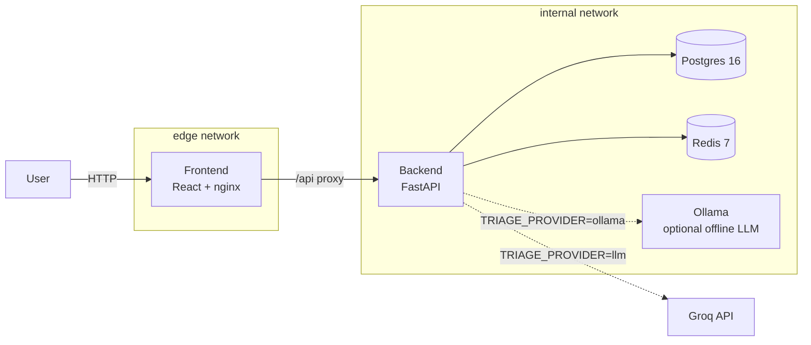

# CivicPulse

[](.github/workflows/ci.yml)
[](.github/workflows/cd.yml)
[](LICENSE)

An end-to-end municipal complaint intake, triage and operations platform.
A citizen submits a complaint; the system validates it, triages it with an
AI provider into a category/priority/summary, persists it, and surfaces it
on a live operations dashboard - as five cooperating containers locally,
and as a scaled, probed, autoscaling workload on Kubernetes in CI.

## Architecture



`frontend` can reach `backend` but never `database`/`cache` directly -
see `compose.yaml`'s two-network split and `docs/ENGINEERING-NOTES.md` Q7.

## Quickstart

```bash
git clone <this-repo>
cd civicpulse
cp .env.example .env
docker compose up --build
docker compose exec backend alembic upgrade head
docker compose exec backend python scripts/seed.py
```

Open **http://localhost:8080**. The API is proxied at `/api` through the
frontend's nginx - no separate host/port needed. Direct backend access
(for `curl`, docs, etc.) is at **http://localhost:8000**.

## API

| Method | Path | Behaviour |
|---|---|---|
| POST | `/api/complaints` | Validate -> triage -> persist. 201 / 400 / 429 |
| GET | `/api/complaints/{id}` | 200 / 404 |
| GET | `/api/complaints` | Filter + paginate |
| PATCH | `/api/complaints/{id}/status` | State-machine transition. 200 / 409 |
| GET | `/api/stats` | Aggregates, Redis-cached 30s, `X-Cache` header |
| GET | `/api/meta/providers` | Active triage provider + last 20 outcomes |
| GET | `/health` | Liveness (never touches the DB) |
| GET | `/ready` | Readiness (checks Postgres + Redis) |
| GET | `/metrics` | Prometheus text format |

## Repository layout

See `civicpulse/` tree - `backend/` (FastAPI, layered: routes -> services
-> repositories -> providers), `frontend/` (React/Vite/TS), `k8s/`
(Kustomize `base/` + `overlays/{dev,prod}`), `.github/workflows/`
(`ci.yml`, `cd.yml`, `release.yml`), `docs/` (ADRs, runbook, engineering
notes, AI usage).

## Screenshots

_(Add screenshots of the Submit, Dashboard, and Stats views here once you
have a running instance to capture - `docs/evidence/`.)_

## Documentation

- [`docs/RUNBOOK.md`](docs/RUNBOOK.md) - deploy, rollback, logs, incident response
- [`docs/ENGINEERING-NOTES.md`](docs/ENGINEERING-NOTES.md) - the assignment's eight required questions
- [`docs/AI-USAGE.md`](docs/AI-USAGE.md) - AI assistance disclosure
- [`docs/adr/`](docs/adr/) - four architecture decision records

## Testing

```bash
cd backend && pytest --cov=app         # 11 tests, ~82% coverage
cd frontend && npm test                 # 8 tests
```

## License

MIT - see [LICENSE](LICENSE).
